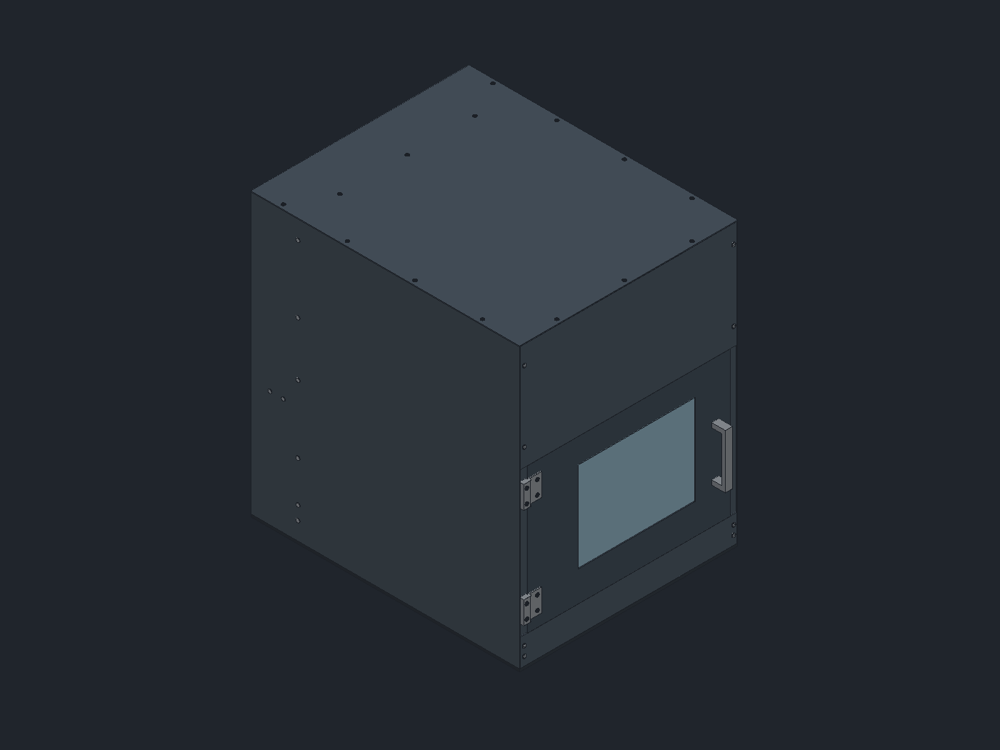
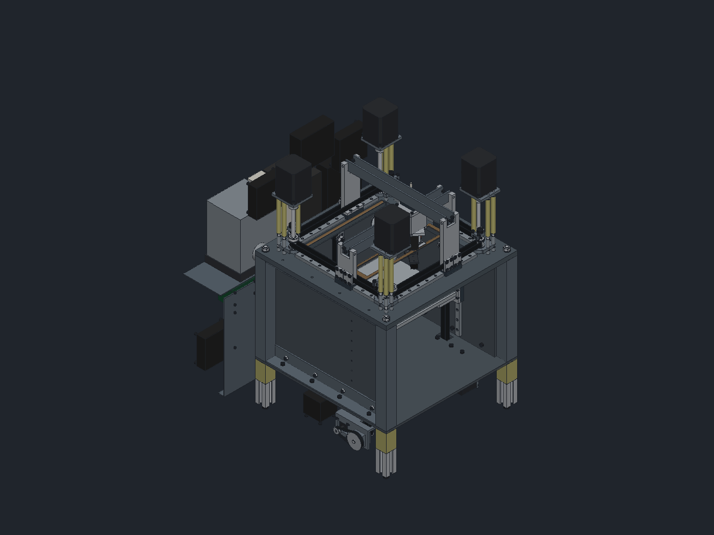

# CroXY

An enclosed cross-XY 3D printer with a 150 °C heated chamber, a 180 × 180 × 180 mm build volume, and
everything that moves in XY mounted on top of one machined steel top plate, out of the chamber. The
extruder rides above the plate too, under the gantry; only the hotend reaches down into the chamber through a cutout in the plate. It is designed in
[rCAD](https://github.com/JonasMerrell/cad-rust-app).

 

## Status

| Area | State |
|---|---|
| Layout sketches (rev B) | approved, [docs/layout-sketches.html](docs/layout-sketches.html) |
| Top plate, corner pulley blocks, motor towers, XY drive, gantry, toolhead yoke | modelled on top of the plate, clearance-checked over full travel |
| Shutter over the plate cutout | modelled: strip moving in Y plus stainless spring-tape covers |
| Frame | steel square-tube posts on M8 tie rods, SCS steel shear plates joined by steel angles, steel floor plate |
| Z system and bed | modelled: 3 belted columns (NEMA17 below the floor), MIC6 bed on 3 arms, clearance-checked over full Z travel. 1:3 belt reduction at each motor |
| Enclosure, insulation, door | modelled: hot-face layer + PIR + skin, double-glazed door, cool Z bay, G10 thermal breaks |
| Chamber heater | modelled: PTC 800 W + blower on the chamber floor, blower motor in the Z bay |
| Back module | modelled: filter loop (cooler, HEPA, carbon, blower) above, electronics below |
| Toolhead | extruder above the plate under the yoke, only the hotend and duct riser through the shutter; centre of mass on both MGN9 rail lines (check: `python3 cad/toolhead.py`). Stand-ins: Sherpa-style gearbox, 36 mm motor on a jackshaft, Chube Conduction, Beacon; milled carrier, printed duct with the Beacon pad |
| Manufacturing | every part has a method (3-axis mill, SCS, waterjet, supportless print, bought) and every screw, nut, rivet, rod and spacer is modelled: [docs/manufacturing.md](docs/manufacturing.md) |

## Build the model

    pip install pyyaml
    python3 cad/build.py path/to/rcad out

This writes:

- `out/CroXY.json`: the rCAD document (one Part Studio per part, plus the `CroXY` assembly). Open it with `rcad out/CroXY.json`.
- `out/CroXY.step`: the assembly as STEP.
- `out/render-*.png`: renders.
- `out/clearance-sweep.json`: interference check with the toolhead at the centre, all four corners and the four edge midpoints of travel, and with the bed at the top and bottom of Z travel.

All key sizes are in [`cad/params.yaml`](cad/params.yaml). Change a number and rebuild.

## How the XY works

- **Above the plate.** The MGN12 rails, belts, pulleys and beams all sit on top of the plate, outside the heated chamber. The plate has a 246 mm square cutout, and the hotend drops through it from the toolhead above. A sliding insulated shutter over the cutout (15 mm of height kept clear for it) keeps chamber air out of the gantry bay.
- **Cross gantry.** The Y beam spans side to side on the Y-end blocks and moves in Y. The X beam spans front to back on the taller X-end blocks, above the Y beam, and moves in X. Each end block is one 3-axis-milled 7075 part: it bolts to its MGN12H carriage, holds the beam end between two cheeks, and anchors both ends of its belt's outer strand in line with the belt: each end is pressed into 11 GT2 tooth grooves milled into the block's outer face by a 7075 clamp plate with four M4 countersunk screws. Belts are tensioned at the corner idlers: a steel slider on the M8 idler axle is pushed by two M5 jack screws (8 mm travel = 16 mm of belt), then the axle clamps it. The toolhead yoke rides an MGN9H on the bottom of each beam and wraps around the Y beam.
- **Toolhead above the plate.** The extruder rides in the cool gantry bay, not in the 150 °C chamber. A milled 7075 carrier bolts under the yoke; the Sherpa-style gearbox hangs under it round the filament, and only a slim column, the Chube Conduction hotend and the part-cooling duct riser, drops through the shutter and the plate cutout. The nozzle sits 20 mm below the plate underside, with the duct ring and the Beacon (on a pad of the duct) just under the plate. The beam stack was raised 39 mm to make room for the extruder under the yoke, and the chamber is 66 mm shorter because the nozzle no longer hangs 86 mm down.
- **Filament.** The nozzle sits 18 mm in X and 15.5 mm in Y from the beam cross. The PTFE tube drops straight down past the X beam, through the yoke top plate, between the Y beam and the yoke leg (the legs stand 6 mm off the beam's sides for it), through the yoke bottom plate and the carrier into the gearbox. The build area is centred under the nozzle, at (18, 15.5) from the frame centre.
- **Toolhead centre of mass on the rails.** A toolhead built round the nozzle would put its weight well off both rail lines, so every move twists the MGN9 carriages. Instead the extruder motor sits across the beam cross as the counterweight: it bolts to a flange milled into the carrier and turns the gearbox's 10T pinion through a flexible coupling and a 5 mm jackshaft that runs under the yoke into two 685 bearings in the gearbox. `cad/toolhead.py` solves the motor position and the gearbox's angle (`toolhead.motor_face_u`, `toolhead.frame_rot`) so the centre of mass of everything the two MGN9H carriages carry lands on the cross; the build asserts it stays within 1 mm. The masses in `params.yaml` are estimates: weigh the real parts and re-solve. No dead weight is added. That centre of mass is at z 60, 16 mm under the Y-beam carriage and 59 mm under the X-beam one (it was 40 and 83 mm under them with the extruder below the plate).
- **Beams.** Bent U-channel backers (mild steel or 4130, Send Cut Send) carry the MGN9 rails. Their size will be set by the dynamic simulation. The rail face is left for finish machining.
- **Perimeter rails and towers.** Four MGN12 rails are screwed to the top of the plate. Each belt runs directly above its rail, and each tower stands on its MGN12H and clamps the inner strand of its belt.
- **Drive.** There are four NEMA23s, one per belt, pinwheeled around the corners on steel motor plates above the X beam. Each motor turns an 8 mm shaft through a rigid coupling. The shaft runs in two 608 bearings in the corner block, so the pulley is in double shear and the motor only sees torque.
- **Corner blocks.** One design is used four times: two 8 mm milled steel plates stacked on four M5 rods with steel spacers, and the motor plate on top on G10 tubes (thermal break). Each block holds its corner's drive pulley and, on an M8 axle, the idler for the neighbouring belt.
- **Tensioning.** Each idler axle sits in a 6 mm slot and is pushed by an M4 set screw in a small tab on the upper plate.
- **Thermal matching.** Everything that carries a steel rail is steel: the top plate, shear plates, corner blocks and beam backers. The towers don't carry rails, so they are 7075 to save moving mass.

## How the Z works

- **Three columns.** Z1 and Z2 are on the left and right shear plates at y = -60, Z3 is on the back shear plate under the build centre. That is the 2 front / 1 back layout for Klipper `z_tilt`.
- **Rails on steel.** Each MGN12 Z rail screws straight to a 6 mm steel shear plate, so rail and mount grow together at 150 °C.
- **Belts.** Each column is a closed GT2 12 mm loop: a 20T drive pulley on a jackshaft below the floor plate, and an idler at the top of the chamber. The belts pass through slots in the floor. Each bed arm clamps the inner strand.
- **1:3 reduction.** Each NEMA17 drives a 60T pulley on the jackshaft through a 20T and a 188 mm GT2 6 mm loop. The jackshaft runs in two 608s in the steel motor mount, and the motor holes are slotted to tension the loop.
- **Bed.** MIC6 200 × 200 × 8 with a silicone heater, centred at (18, 25) under the nozzle, carried on three milled 7075 arms (countersunk M4 over G10 washers). Each arm clamps its belt with a separate clamp plate.
- **Drive brackets.** Each Z drive hangs on a bent 5 mm steel bracket from three G10 tubes under the floor plate, with a milled bearing block either side of the web. The top idler sits on an M8 through a slot in the shear plate for belt tension.
- **Open item.** With about 2 kg moving, each motor sees roughly its own detent torque at power-off through the 1:3. If the bed still creeps, go 1:4 or add a brake.

## How the enclosure works

- **Walls.** Outside the frame: 15 mm hot-face layer (aerogel blanket or mineral wool board) so the 30 mm PIR board stays below its temperature limit, then a 2 mm aluminium skin. The front door has the same build-up and a double-glazed window.
- **Floor.** The floor plate stands on four G10 blocks (thermal breaks) through the floor insulation, on 3030 legs in the cool Z bay. One M8 tie rod per corner runs from the top plate through the post, floor plate and G10 block into the leg. The Z drives hang from the floor plate on G10 tubes, so the steel floor doesn't heat the motors.
- **Skin.** Bent 2 mm 5052 panels from Send Cut Send, riveted at the corners; every fixing sits in the bays or the back module, outside the insulation. The side panels run back past the back module and their front flanges are the door jambs. The lid and rear covers screw into rivnuts.
- **Door.** Bent aluminium pan, riveted stainless inner sheet, hot-face and PIR boards inside, both panes bonded with high-temperature RTV, two lift-off hinges.
- **Shutter.** A strip moves in Y with the hotend column. Thin stainless spring-tape covers close the rest of the cutout: front and back from rollers sunk into pockets in the plate top, left and right of the column from reels on the strip ends, just outside the cutout edge.
- **Heater.** An 800 W PTC heater (two elements) and blower wheel sit on the chamber floor to the left of the bed. The blower motor is below the floor in the cool bay.
- **Gantry bay.** Ventilated with two 80 mm fans in the back wall. The part-cooling blower sits here and feeds the duct riser on the toolhead through a hose.
- **Back module.** The filter loop (air-to-air cooler, HEPA, carbon, blower) sits above the electronics bay (Kraken, 48 V and 24 V PSUs, host, fans). Each has its own rear cover.
- **Outside size.** 484 W × 596 D × 669 H mm (plus the door handle).

## How it is made

[docs/manufacturing.md](docs/manufacturing.md) lists every part with its method, material, setups or print orientation, and the full fastener list; `python3 cad/mfg_doc.py out` regenerates it after a build. CNC parts need only a 3-axis mill, printed parts need no supports (PPS-CF in the hot zone, PET-CF outside), and there is no welding or lathe work.

## Engineering checks

First-pass numbers (heat loss, heat-up time, PIR temperature, moving mass, beam stiffness, power) are in [docs/analysis.md](docs/analysis.md).

## Decisions made so far

See [docs/spec.yaml](docs/spec.yaml) for the full spec. Changes from the approved sketches:

- The frame is 380 mm (was 340) so each corner block fits its drive pulley, the other belt's idler, and 6 mm of tension travel.
- The back centre post is replaced by a steel back shear plate carrying the Z3 rail. The post would have cut through the X-back belt.
- The XY system moved from under the plate to on top of it (belts and rails out of the chamber), with a cutout for the toolhead. That lets the chamber shrink to 320 mm tall (beams no longer take up chamber height; 33 mm goes to hanging the toolhead below the plate).
- The extruder moved above the plate, under the yoke (2026-11-09). The beams went up 39 mm and the chamber came down to 254 mm, so the printer is 27 mm shorter and the toolhead's centre of mass sits much closer to the carriages.
