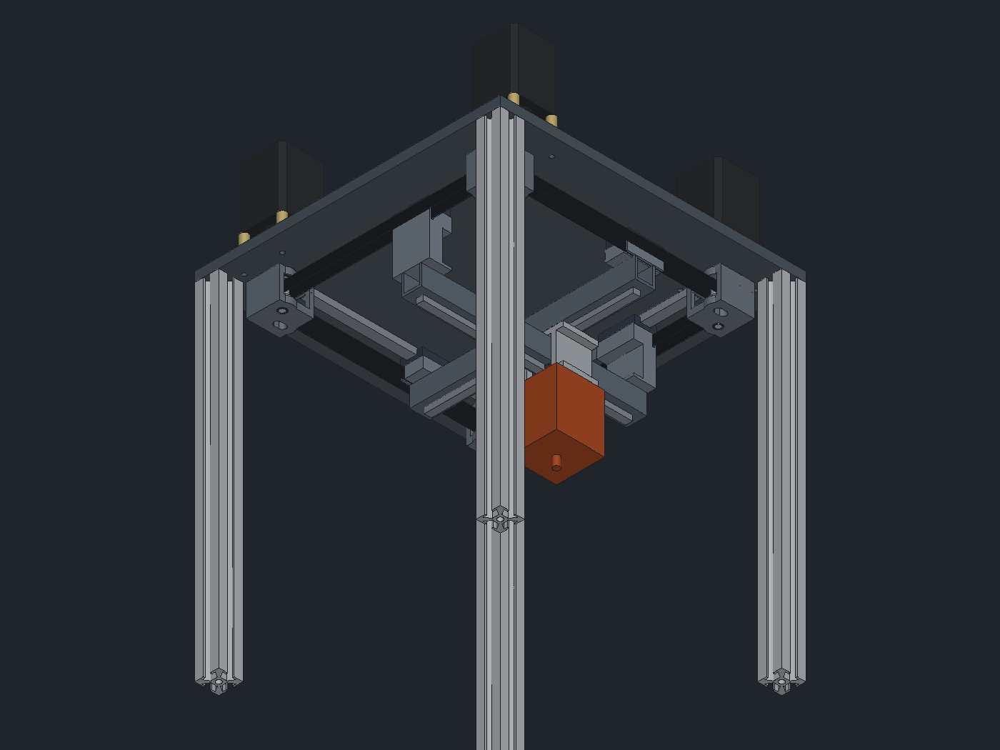

# CroXY

An enclosed cross-XY 3D printer with a 150 °C heated chamber, a 180 × 180 × 180 mm build volume, and
everything that moves in XY hung from one machined steel top plate. It is designed in
[rCAD](https://github.com/JonasMerrell/cad-rust-app).

## Status

| Area | State |
|---|---|
| Layout sketches (rev B) | approved, [docs/layout-sketches.html](docs/layout-sketches.html) |
| Top plate, corner pulley blocks, XY drive, gantry, toolhead yoke | first model, clearance-checked over full travel |
| Frame posts | placed (3030 × 430); floor plate, back shear plate, panels not yet |
| Z system and bed | not started |
| Enclosure, insulation, door, back module (filter + electronics) | not started |
| Toolhead | envelope stand-in only (Chube Conduction + Sherpa Heavy) |

## Build the model

    pip install pyyaml
    python3 cad/build.py path/to/rcad out

This writes:

- `out/CroXY.json`: the rCAD document (one Part Studio per part, plus the `CroXY` assembly). Open it with `rcad out/CroXY.json`.
- `out/CroXY-xy.step`: the assembly as STEP.
- `out/render-*.png`: renders.
- `out/clearance-sweep.json`: interference check with the toolhead at the centre, all four corners and the four edge midpoints of travel.

All key sizes are in [`cad/params.yaml`](cad/params.yaml). Change a number and rebuild.

## How the XY works

- **Cross gantry.** The X beam spans front to back and moves in X. The Y beam spans side to side, 18 mm lower, and moves in Y. The toolhead yoke rides an MGN9H on the bottom of each beam and wraps around the Y beam, so both beams drive the toolhead directly.
- **Beams.** Bent U-channel backers (mild steel or 4130, Send Cut Send) carry MGN9 rails. Their size will be set by the dynamic simulation. The rail face is left for finish machining.
- **Perimeter rails.** Four MGN12 rails are screwed to the underside of the top plate. The X beam hangs from the X-end adapters, and the Y beam hangs from the taller Y-end drop blocks.
- **Drive.** There are four NEMA23s, one per belt, pinwheeled around the corners on 30 mm G10 thermal-break standoffs above the plate. Each motor turns an 8 mm shaft through a coupling. The shaft runs in two 608 bearings in a steel corner block under the plate, so the pulley is in double shear and the motor only sees torque.
- **Corner blocks.** One design is used four times. Each block holds its corner's drive pulley and the idler for the neighbouring belt.
- **Tensioning.** Each idler sits in a 6 mm slot and is adjusted from above the plate.
- **Belts.** Gates EPDM GT2 12 mm. Each beam end clamps the inner strand of its belt.
- **Thermal matching.** The top plate, floor plate, corner blocks, adapters and beam backers are all steel, so the steel rails don't bow as the chamber heats.

## Decisions made so far

See [docs/spec.yaml](docs/spec.yaml) for the full spec. Changes from the approved sketches:

- The frame is 380 mm (was 340) so each corner block fits its drive pulley, the other belt's idler, and 6 mm of tension travel.
- The back centre post is replaced by a steel back shear plate carrying the Z3 rail. The post would have cut through the X-back belt.
- The chamber is 430 mm tall (was 360) to fit the stacked beams and a ~85 mm toolhead above 180 mm of Z travel.
