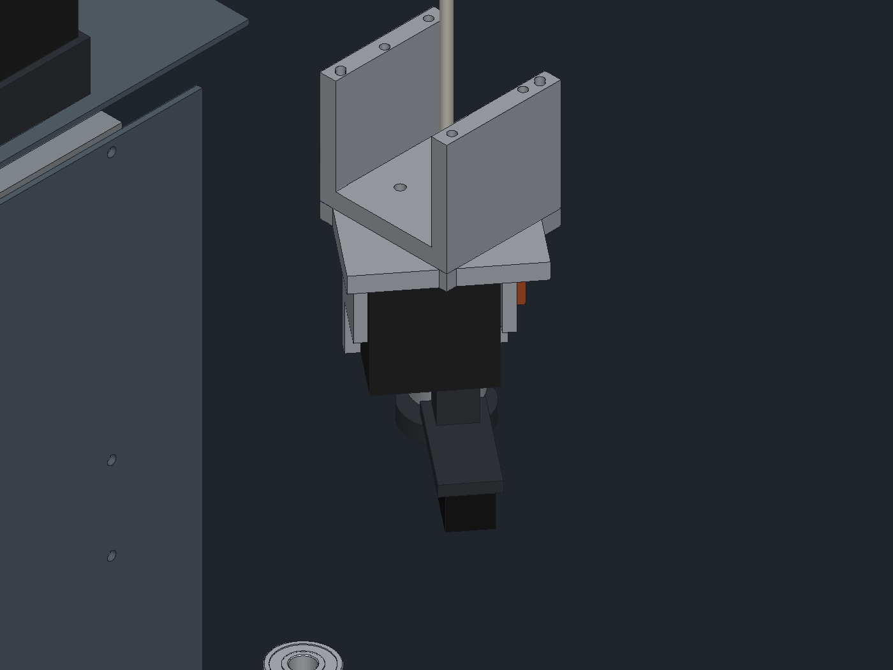

# CroXY first-pass engineering checks

Hand calculations behind the fine-tuning pass (2026-11-08). They are estimates to size things,
not a substitute for the dynamic simulation of the gantry or a thermal test of the built chamber.
Ambient 25 °C, chamber 150 °C.

## Insulation and heat loss

| Hot-face layer | Wall U (W/m²K) | PIR hot face |
|---|---|---|
| 15 mm | 0.51 | 102 °C |
| **20 mm (chosen)** | **0.46** | **95 °C** |
| 25 mm | 0.42 | 89 °C |

Assumes aerogel blanket k ≈ 0.024 and aged PIR k ≈ 0.027 W/mK at temperature. Check the chosen
PIR board's continuous rating (most are 100 to 120 °C); 20 mm keeps it under 100 °C.

Heat loss at 150 °C:

| Path | W |
|---|---|
| Side and back walls | 25 |
| Floor | 8 |
| G10 supports and Z hangers | 4 |
| Door, opaque | 7 |
| Window (double glazed, U ≈ 2.8) | 21 |
| Top plate and shutter (to the ventilated gantry bay) | 91 |
| Shutter gaps and leakage (guess) | 25 |
| Filter loop, 2 m³/h cooled from 150 to 50 °C | 47 |
| **Total** | **≈ 230** |

The top is the biggest loss. The steel top plate settles at about 85 to 90 °C with the gantry bay
ventilated, so the MGN12 rails and carriages run near that: use high-temperature grease. The belts
run in the bay air above it.

## Heat-up time

About 1.9 MJ goes into the steel and aluminium inside the envelope (shear plates, floor plate,
posts, bed, arms, part of the top plate).

| Chamber heater | 10 mm floor | 6 mm floor |
|---|---|---|
| 300 W | 195 min | 170 min |
| 600 W | 75 min | 65 min |
| **800 W (chosen)** | 53 min | **46 min** |
| 1000 W | 41 min | 36 min |

The bed heater adds heat on top of this, so real heat-up is shorter.

## Z holding

Moving bed ≈ 2.1 kg (MIC6, arms, carriages, heater, sheet). Through the 1:3 reduction each NEMA17
holds about 15 mN·m at power-off, roughly its detent torque. If the motors are off the bed can
creep down, which is away from the nozzle (safe). Park the bed low before disabling the motors.

## XY moving mass and acceleration

| | X axis | Y axis |
|---|---|---|
| Moving mass, steel towers | 2.07 kg | 1.70 kg |
| **Moving mass, 7075 towers (chosen)** | **1.68 kg** | **1.55 kg** |

The towers don't carry rails, so they don't need to match steel's expansion. With two NEMA23s per
axis at about 0.8 N·m each at speed, and the motor rotors included (≈ 1.2 kg equivalent each on a
20T pulley), the limit is about 60 m/s².

## Toolhead centre of mass

Everything the two MGN9H carriages carry (yoke, carrier, extruder, hotend, duct, carriages), from
`python3 cad/toolhead.py` with the estimated bought-part masses in `params.yaml`:

| Layout | Mass | CoM offset from the cross (x, y) | CoM below the Y / X carriage faces | Nozzle below the plate |
|---|---|---|---|---|
| Original: everything round the nozzle, under the plate | ≈ 625 g | (9.6, 16.9) mm | 40 / 83 mm | 86 mm |
| Diagonal, motor as counterweight, under the plate (PR #1, first commit) | ≈ 660 g | (0.3, -0.2) mm | 40 / 83 mm | 86 mm |
| **Now: extruder above the plate under the yoke, beams +39 mm** | **≈ 547 g** | **(0.0, 0.0) mm** | **16 / 59 mm** | **20 mm** |

At 60 m/s² the original offset put about 0.7 N·m of yaw and roll on the carriages on every move. The
vertical lever now gives about 0.5 to 1.9 N·m of pitch/roll shared by the yoke and both carriages, down
from 1.6 to 3.3 N·m. The neck and the toolhead plate are gone, so the carried mass dropped by about 110 g.
The extruder motor and gearbox now run in the gantry bay instead of the 150 °C chamber, so filament is not
softened at the drive gears and the motor needs no high-temperature rating.

## Beam backer (input for the dynamic simulation)

25 × 25 × 3 steel U channel with the MGN9 rail: I ≈ 20,400 mm⁴ both ways. Over the 286 mm span the
first bending mode with the toolhead at mid-span is about 470 Hz (pinned ends) to 940 Hz (fixed
ends). The beam is far stiffer than the belts, so the simulation should focus on belt stiffness and
the tower joints. A 2 mm wall would save about 0.3 kg of moving mass and still be well above the
belt modes.

## Power

- 48 V (LRS-350-48 class): 4 × NEMA23 plus 3 × NEMA17, about 150 to 200 W peak. OK.
- 24 V: the old 150 W unit was too small for the hotend (about 100 W), the server blower (up to
  about 60 W), fans, Beacon and logic. Changed to the 350 W class.
- Mains: chamber heater 800 W and bed heater (about 400 to 600 W) plus the PSUs. On a 120 V/15 A
  circuit, cap total heater power in Klipper, or wire the chamber heater for 600 W.
